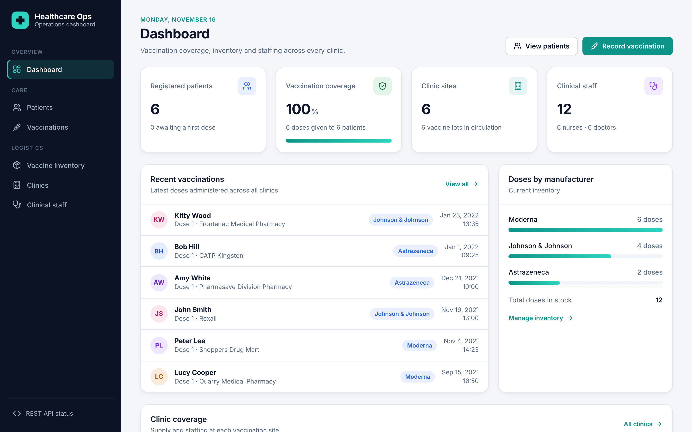
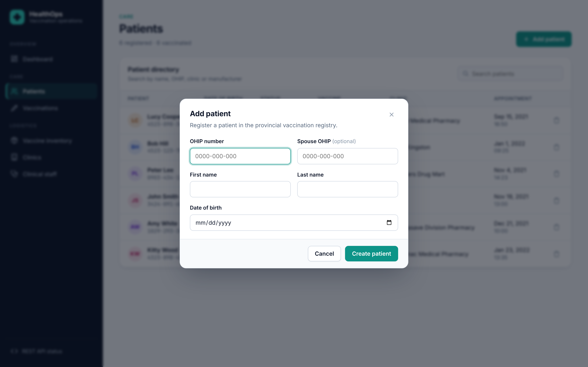
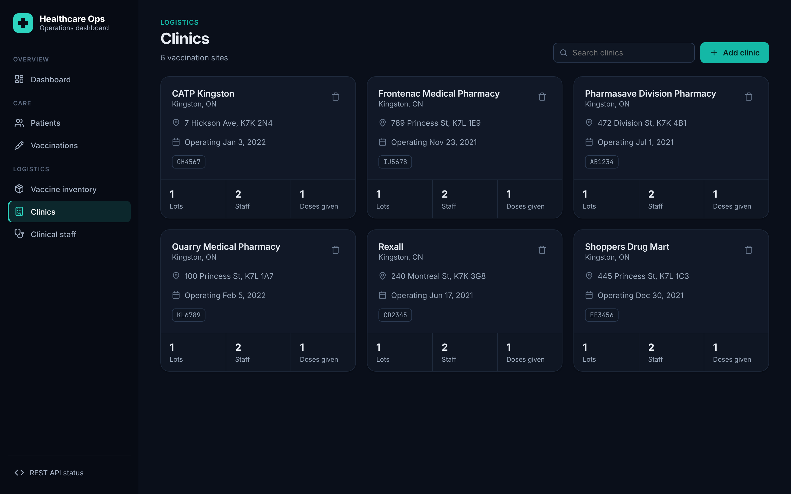

# Healthcare Operations Dashboard

[](https://github.com/Penelope-Liang/Healthcare_Operation_System/actions/workflows/qa.yml)
[](https://github.com/Penelope-Liang/Healthcare_Operation_System/actions/workflows/docker.yml)

A full-stack healthcare operations dashboard covering the patient registry,
vaccination records, vaccine lot inventory and shipments, clinic sites, and clinical staff assignments.
A **Spring Boot** REST API over MySQL powers a **Vue 3** single-page frontend; both ship together as one jar.



| Add patient dialog | Clinics (dark mode) |
| --- | --- |
|  |  |

## Features

- **Dashboard**: patient count, vaccination coverage, clinic and staff totals, recent vaccinations, doses by manufacturer, and a per-clinic supply/staffing status table
- **Patients**: searchable directory showing each patient's vaccination status, dose count and most recent dose, plus forms to register or remove patients
- **Vaccinations**: record first doses, second doses and boosters (patient, clinic, lot, date and time); each record shows its dose number
- **Vaccine inventory**: lots with production and expiry dates, an automatic *Expired* badge, dose totals, and shipment assignment from lot to clinic
- **Clinics**: a card for each site with its address, operating date, shipped lots, staff count and doses given
- **Clinical staff**: nurses and doctors with any number of credentials and clinic assignments, filterable by role
- **REST API**: CRUD for every resource, with field-level validation errors and clear 404 / 409 responses
- Responsive layout that becomes a top navigation bar on phones, automatic dark mode, and accessible dialogs, labels and focus states
- When MySQL is down, the API returns 503 and each page shows how to fix it, instead of crashing

## Tech stack

| Layer | Technology |
| --- | --- |
| Language / runtime | Java 21 |
| Framework | Spring Boot 3.3 (Spring MVC, Bean Validation) |
| Frontend | Vue 3 (Composition API, `<script setup>`), Vue Router, Vite, hand-written CSS design system |
| Data access | Spring `JdbcClient` with plain SQL |
| Database | MySQL 8 (production), H2 in MySQL mode (`demo` profile and tests) |
| Tests | JUnit 5 + MockMvc, Vitest + Vue Test Utils, Playwright (UI + API), JaCoCo coverage |
| CI/CD | GitHub Actions (tests against a MySQL service container, Docker image published to GHCR), Dependabot |
| Packaging | Multi-stage Dockerfile, Docker Compose with MySQL |

## Project structure

```text
.
|-- src/                                 Spring Boot backend (REST API only)
|   |-- main/java/com/healthops/
|   |   |-- config/                      JSON input trimming
|   |   |-- domain/                      records: Patient, Clinic, VaccineLot, StaffMember, ...
|   |   |-- repository/                  SQL via JdbcClient, one class per aggregate
|   |   `-- web/
|   |       |-- api/                     REST controllers + JSON error handling
|   |       |-- form/                    validated request objects (Bean Validation)
|   |       `-- SpaController.java       serves index.html for Vue routes
|   |-- main/resources/
|   |   |-- application.yml              MySQL settings (env-var driven)
|   |   `-- application-demo.yml         in-memory H2 profile
|   `-- test/java/                       JUnit / MockMvc integration tests
|-- frontend/                            Vue 3 + Vite single-page app
|   |-- src/
|   |   |-- views/                       one page per route (Dashboard, Patients, ...)
|   |   |-- components/                  sidebar, dialog, form field, avatar, search, toasts
|   |   |-- composables/                 useResource, useForm, useToasts
|   |   |-- lib/                         API client, date and text helpers
|   |   |-- assets/app.css               design system (light + dark)
|   |   |-- router.js
|   |   `-- App.vue
|   `-- tests/                           Vitest unit + component tests
|-- database/
|   |-- schema.sql                       MySQL schema (also used by the H2 demo profile)
|   `-- seed.sql                         sample data
|-- tests/e2e/                           Playwright UI + API tests
|-- qa/                                  test plan, cases, traceability, bug reports
|-- .github/
|   |-- workflows/qa.yml                 build, tests, coverage
|   |-- workflows/docker.yml             build, smoke-test and publish the Docker image
|   `-- dependabot.yml                   weekly dependency updates
|-- Dockerfile                           multi-stage build: Vue -> Spring Boot jar -> JRE image
|-- docker-compose.yml                   app + MySQL 8 for local use
`-- pom.xml                              Maven build (also builds the frontend)
```

## Running locally

Requirements: **JDK 21**, **Maven 3.9+** and **Node.js 20+**. `mvn package` runs `npm install` and `npm run build`
in `frontend/` and bundles the result into the jar. Add `-DskipFrontend` to build only the Java side.

### Option 1: demo mode (no database to install)

```bash
mvn package
```

```bash
java -jar target/healthops.jar --spring.profiles.active=demo
```

Open http://localhost:8080. Demo mode uses an in-memory H2 database loaded with the same sample data as
`database/seed.sql`. Changes are lost when the app stops.

### Option 2: MySQL

Import the database:

```bash
mysql -u root -e "CREATE DATABASE healthops"
```

```bash
mysql -u root healthops < database/schema.sql
```

```bash
mysql -u root healthops < database/seed.sql
```

Start the app:

```bash
java -jar target/healthops.jar
```

Connection settings come from environment variables:

| Variable | Default |
| --- | --- |
| `DB_HOST` | `localhost` |
| `DB_PORT` | `3306` |
| `DB_NAME` | `healthops` |
| `DB_USER` | `root` |
| `DB_PASSWORD` | *(empty)* |
| `PORT` | `8080` |

### Option 3: Docker

Run with the in-memory demo database:

```bash
docker build -t healthcare-dashboard .
```

```bash
docker run -p 8080:8080 -e SPRING_PROFILES_ACTIVE=demo healthcare-dashboard
```

Or run the app together with a MySQL 8 container. The database is created from `database/schema.sql` and
`database/seed.sql` on first start:

```bash
docker compose up --build
```

`docker compose down -v` stops everything and resets the database. Every push to `main` also publishes the image
to GitHub Container Registry as `ghcr.io/penelope-liang/healthcare_operation_system:latest`.

### Frontend development (hot reload)

Run the API in one terminal:

```bash
mvn spring-boot:run -DskipFrontend -Dspring-boot.run.profiles=demo
```

Run the Vite dev server in another:

```bash
npm --prefix frontend run dev
```

Open http://localhost:5173. Vite proxies `/api` to the Spring Boot app on port 8080, and edits to `.vue` files show up instantly.

## REST API

All endpoints accept and return JSON. Dates use `YYYY-MM-DD` and times use `HH:MM`.

| Resource | Endpoints |
| --- | --- |
| Health | `GET /api/health` |
| Page views | `GET /api/dashboard`, `/api/patients/overview`, `/api/vaccinations/details`, `/api/clinics/overview`, `/api/companies` |
| Patients | `GET/POST /api/patients`, `GET/PUT/DELETE /api/patients/{ohip}` |
| Clinics | `GET/POST /api/clinics`, `GET/PUT/DELETE /api/clinics/{name}` |
| Vaccine lots | `GET/POST /api/vaccines`, `GET/PUT/DELETE /api/vaccines/{lot}` |
| Shipments | `GET/POST /api/shipments`, `GET/DELETE /api/shipments/{lot}/{clinic}` |
| Vaccinations | `GET/POST /api/vaccinations`, `GET/PUT/DELETE /api/vaccinations/{id}` |
| Staff | `GET /api/staff[?role=nurse\|doctor]`, `POST /api/staff`, `GET/PUT/DELETE /api/staff/{id}` |

Example:

```bash
curl -X POST localhost:8080/api/patients -H 'Content-Type: application/json' \
  -d '{"ohip":"1234-567-890","firstName":"Grace","lastName":"Hopper","dateOfBirth":"1985-12-09"}'
```

Status codes: `201` created (with a `Location` header), `204` deleted, `400` malformed JSON,
`404` not found, `409` duplicate or still-referenced record, `422` validation failed, `503` database unavailable.
A validation error looks like this:

```json
{
  "status": 422,
  "error": "Please correct the invalid fields.",
  "fieldErrors": { "ohip": "OHIP must use the format 0000-000-000." }
}
```

## Testing

```bash
mvn verify
```

This runs the JUnit + MockMvc tests: REST CRUD, validation, conflicts, the overview endpoints, Vue route forwarding,
and behavior when MySQL is down. JaCoCo then writes a coverage report to `target/site/jacoco/index.html`, and the
build fails if line coverage drops below 85%. CI shows the coverage numbers in each run's summary and uploads the
full report as an artifact.

## CI/CD

| Workflow | Runs on | What it does |
| --- | --- | --- |
| `qa.yml` | every push and pull request | Builds the app, runs JUnit (with the coverage check), Vitest and Playwright (against MySQL 8), and uploads the coverage and Playwright reports |
| `docker.yml` | pull requests and pushes to `main` | Builds the Docker image and smoke-tests it; on `main` it also publishes `latest` and `sha-<commit>` tags to GitHub Container Registry |
| Dependabot | weekly | Opens pull requests for Maven, npm, GitHub Actions and Docker base image updates |

```bash
npm install
```

```bash
npm run build
```

```bash
npm test
```

`npm test` runs the Vitest frontend tests and the Playwright UI and API tests. Playwright starts the packaged jar in
`demo` mode automatically. To run the end-to-end tests against MySQL instead, set `SPRING_PROFILES_ACTIVE=default`
(plus the `DB_*` variables if needed). To test an app that is already running, set `BASE_URL`.

```bash
npm run test:report
```

This opens the latest Playwright HTML report.

QA references: `qa/test-plan.md`, `qa/test-cases.md`, `qa/traceability-matrix.md`, `qa/bug-report-template.md`,
`qa/sample-bug-reports.md`, `qa/ai-test-review-checklist.md`, `qa/platform-scope.md`.

## Data model

`database/schema.sql` defines ten tables:

| Table | Purpose |
| --- | --- |
| `patient` | Patients, keyed by OHIP number |
| `spouse` | At most one spouse per patient (the only place spouse data lives) |
| `company` | Vaccine manufacturers |
| `vaccine_lot` | Lots with production/expiry dates and dose counts |
| `clinic` | Vaccination sites |
| `shipment` | Which lots were delivered to which clinics |
| `staff` | Nurses and doctors in one table, told apart by `role` |
| `staff_credential` | Any number of credentials per staff member |
| `staff_assignment` | Any number of clinic assignments per staff member |
| `vaccination` | One row per dose, so patients can have second doses and boosters |

Design notes:

- Dates and times use real `DATE` / `TIME` columns, and the database checks that doses are not negative and that a lot expires after it was produced.
- Delete rules are explicit. Removing a lot or clinic also removes its shipments and staff assignments. Removing a patient also removes their spouse record. Patients, clinics and lots that appear in vaccination history cannot be deleted.
